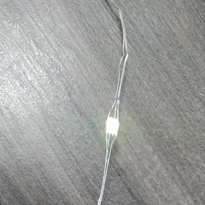
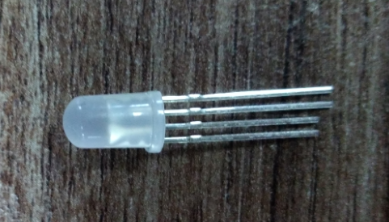
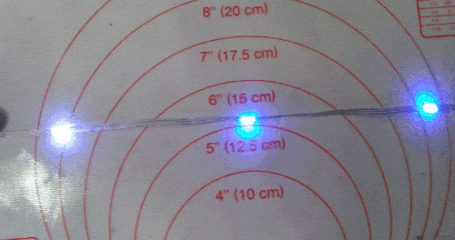
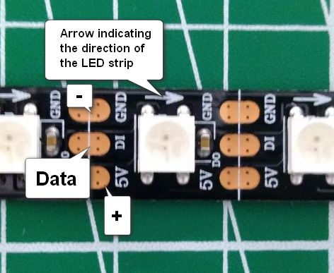

# How to repair LEDs on your ETERESHOP product

Part of your costume or prop does not light up? In most cases one LED has burned out or a wire has come loose. It is easy to fix at home, and you do not need any experience. Just follow the steps below.

**Contents**

1. [Before you start: check the batteries](#1-before-you-start-check-the-batteries)
2. [Is it really an LED problem?](#2-is-it-really-an-led-problem)
3. [Safety first](#3-safety-first)
4. [What you need](#4-what-you-need)
5. [Find the broken spot](#5-find-the-broken-spot)
6. [Find your type of LEDs](#6-find-your-type-of-leds)
7. [Repair instructions for your type](#7-repair-instructions)
8. [Still not working?](#8-still-not-working)

---

## 1. Before you start: check the batteries

Weak or wrong batteries cause most "LED problems". Before repairing anything, make sure that:

- you use the **correct batteries**: [What batteries are needed?](https://github.com/etereshop-sales/All-about-batteries)
- the batteries are **fully charged**: [How to charge 18650 batteries with an Imax B6 charger](https://github.com/etereshop-sales/All-about-batteries?tab=readme-ov-file#-step-1-charging-batteries-with-a-conventional-splitter)

---

## 2. Is it really an LED problem?

Find your symptom in the table:

| What you see | What it most likely is | What to do |
|---|---|---|
| Nothing lights up at all | Batteries, battery connector or controller | Check the batteries and connectors. See [Typical problems](https://github.com/etereshop-sales/Typical-problems-and-product-configuration) |
| Effects jerk, freeze or the product blinks | Weak or wrong batteries | Charge or replace the batteries (section 1) |
| **One part works, but from some point on everything is dark** | **A burned-out LED or a broken wire at that point** | **This guide. Go on to section 3** |
| From some point on the colours are wrong or flicker randomly | A damaged LED at that point | This guide. Go on to section 3 |
| One single LED is dark, the ones after it work | That one LED is damaged | This guide. Replace just this LED |

---

## 3. Safety first

> [!IMPORTANT]
> **Always disconnect the power before you cut, twist or solder anything:** take out the batteries or unplug the battery box.
> Connect the power only for a short test, and disconnect it again before you continue working.

- Work on a table, not while wearing the costume.
- Be careful with the knife, the lighter and the soldering iron. Keep the flame away from fabric and feathers.
- If you use superglue, do not get it on your fingers or on the LED lens.

---

## 4. What you need

Your order comes with a **repair kit** with spare LEDs (or pieces of strip) for your product. If you cannot find it or something is missing, write to us (section 8).

You will also need:

- scissors or wire cutters
- a small sharp knife
- heat shrink tubing (thin plastic tubes that shrink when heated and cover the connection)
- a lighter or a hair dryer to shrink the tubing
- *optional, but better:* a soldering iron and solder
- *optional:* hot glue gun for extra protection, superglue (only for LED jackets)

---

## 5. Find the broken spot

The signal travels through the LEDs one after another, in one direction, from the controller to the end of the line. When one LED breaks, **all LEDs after it go dark** (or show wrong colours).

1. Turn the product on with a simple effect, for example one colour on all LEDs.
2. Follow the line of LEDs from the controller. Find the **last LED that lights up** and the **first LED that does not**.
3. The problem is in one of these two LEDs or in the wire between them.
4. Turn the power off and mark both LEDs (a piece of tape is fine).

> [!TIP]
> **Replace both of these LEDs**, not only the dark one. Very often the one that still lights up is the damaged one: it lights itself but no longer passes the signal on. Replacing both fixes the problem the first time.

**The direction matters.** Every LED and strip has a direction: an arrow on the strip, or a dot on the LED. A new LED must be put in **the same way as its neighbours**. If it is turned the other way, everything after it stays dark.

---

## 6. Find your type of LEDs

Look at your product and find the picture that matches it, then go to that section.

| Picture | What it looks like | Typical products | Instructions |
|---|---|---|---|
|  | Small separate LEDs with **4 very thin wires** coming out of each side | Belly dance costumes, older Peacock Tails, ballet tutus, angel wings | [Type A](#type-a-separate-leds-on-thin-wires) |
|  | Round LEDs with **4 metal legs**, connected by wires into strips | LED jackets | [Type B](#type-b-round-leds-with-4-legs-led-jackets) |
|  | **Flat strip** (black or white) with square LEDs, copper pads and printed labels **GND, DI/DO, 5V** and arrows | Various products | [Type C](#type-c-flat-factory-led-strip) |
|  | LEDs in small **clear drops** on **3 parallel transparent wires**, no flat strip | Newer products | [Type D](#type-d-leds-on-3-clear-wires-new-flexible-strip) |

Not sure? Take a photo of the dark spot and send it to us (section 8). We will tell you the type.

---

## 7. Repair instructions

Every type has the same three connections. You always connect **the same wire to the same wire**:

| Wire | Also called | Meaning |
|---|---|---|
| **+** | 5V, VCC | power plus |
| **−** | GND | power minus |
| **DATA** | DI (data in), DO (data out) | the signal that carries the effect |

### Type A: separate LEDs on thin wires

📺 Video: [Watch on YouTube](https://www.youtube.com/watch?v=c3QmbBcWxTw)

**How to tell the wires apart.** The dot on the LED points to the **minus (−)** wire. The DATA wire is in the middle, the plus (+) is on the other side. The arrow shows the direction.

**Steps** (power is off):

1. Cut out the broken LED, leaving the wires of the neighbouring LEDs as long as possible.
2. Take a new LED from the repair kit. Turn it **the same way** as its neighbours: dot on the same side, same direction.
3. These wires are covered with a thin transparent varnish, and the connection will not work through it. **Scrape the varnish off** the last 5–10 mm of each wire with a knife or fine sandpaper until the metal is shiny.
4. Slide a small piece of heat shrink tubing onto each wire.
5. Connect the wires: **+ to +, DATA to DATA, − to −**. Twist each pair tightly, or better, solder them if you have a soldering iron.
6. Make sure the bare connections do not touch each other.
7. Short test: connect the power. If the LEDs after the repair light up, disconnect the power again.
8. Slide the heat shrink over each connection and heat it with a lighter or hair dryer until it shrinks.

### Type B: round LEDs with 4 legs (LED jackets)

📺 Video: [Watch on YouTube](https://www.youtube.com/watch?v=rEJG0qQuwB4)

In jackets the LEDs are connected into short strips. You do not repair one LED here: **you replace the whole short strip** that has the broken LED or wire.

**Steps** (power is off):

1. Find the short strip with the broken spot (section 5).
2. Carefully push the LEDs of this strip out of the eyelets in the jacket.
3. Remove the heat shrink tubing and the tape at both ends of the strip, where it connects to the next strips.
4. Disconnect the old strip and take a new one from the repair kit. Check that it points in **the same direction** as the old one.
5. Slide heat shrink tubing onto the wires of the new strip.
6. Connect the ends: **+ to +, DATA to DATA, − to −** (twist tightly or solder).
7. Short test: connect the power and check that the jacket lights up. Disconnect the power.
8. Cover the connections with heat shrink and heat it.
9. Put the LEDs back into the eyelets and fix each one with a drop of superglue.

### Type C: flat factory LED strip

📺 Video: [Watch on YouTube](https://www.youtube.com/watch?v=XLc9dmGdp3g)

Here everything is printed on the strip: the **arrow** shows the direction, and the pads are labelled **GND (−)**, **DI/DO (DATA)** and **5V (+)**.

**Steps** (power is off):

1. Cut the strip along the thin white line across the copper pads, before and after the broken LEDs. Cut through the middle of the pads so that some copper stays on both sides.
2. Take a piece of strip from the repair kit with the same number of LEDs. Check that its **arrows point the same way** as on the rest of the strip.
3. Connect the pads with short wires or solder them directly: **5V to 5V, DI/DO to DI/DO, GND to GND**.
4. Short test: connect the power, check, disconnect.
5. Cover the joints with heat shrink tubing or hot glue.

A soldering iron is needed for this type. If you do not have one, write to us (section 8).

### Type D: LEDs on 3 clear wires (new flexible strip)

📺 Video, two methods: [Watch on YouTube](https://www.youtube.com/watch?v=FBgQjQYbFiI)

**How to tell the wires apart.** The plus (+) wire has a **copper-coloured core** (on wires of other colours it is marked with dots). The DATA wire is in the middle, the minus (−) is on the other side.

There are two ways to repair this type:

- **Twisting**: an emergency method if you do not have a soldering iron with you. Good for a quick fix before a show.
- **Soldering**: a reliable permanent repair.

**Steps** (power is off):

1. Lay the strip in front of you with the LED drops facing up.
2. Cut out the broken LEDs with scissors or wire cutters.
3. Take a piece from the repair kit and turn it **the same direction** as the rest of the strip.
4. Pull the three wires apart a little at each end.
5. Strip about 5–10 mm of insulation from each wire with the knife or wire cutters.
6. Slide a piece of heat shrink tubing onto each wire.
7. Connect the wires: **copper (+) to copper (+), middle to middle, the third to the third.**
   - **Twisting:** twist each pair tightly together.
   - **Soldering:** cover the bare wire ends with a little solder first ("tinning"), then hold them together and solder.
8. Make sure the bare connections do not touch each other.
9. Short test: connect the power. If it does not light up, check that you did not mix up the wires or the direction. Disconnect the power.
10. Slide the heat shrink over each connection and heat it with a lighter or hair dryer.
11. *Optional:* add a little hot glue over the joint for extra strength and water protection.

---

## 8. Still not working?

Write to **sales@etereshop.com** and send us:

- your order number
- a photo of the dark spot (close-up, so that the LEDs and wires are visible)
- a short video of the product turned on

We will help you find the problem or send you a new repair kit.
